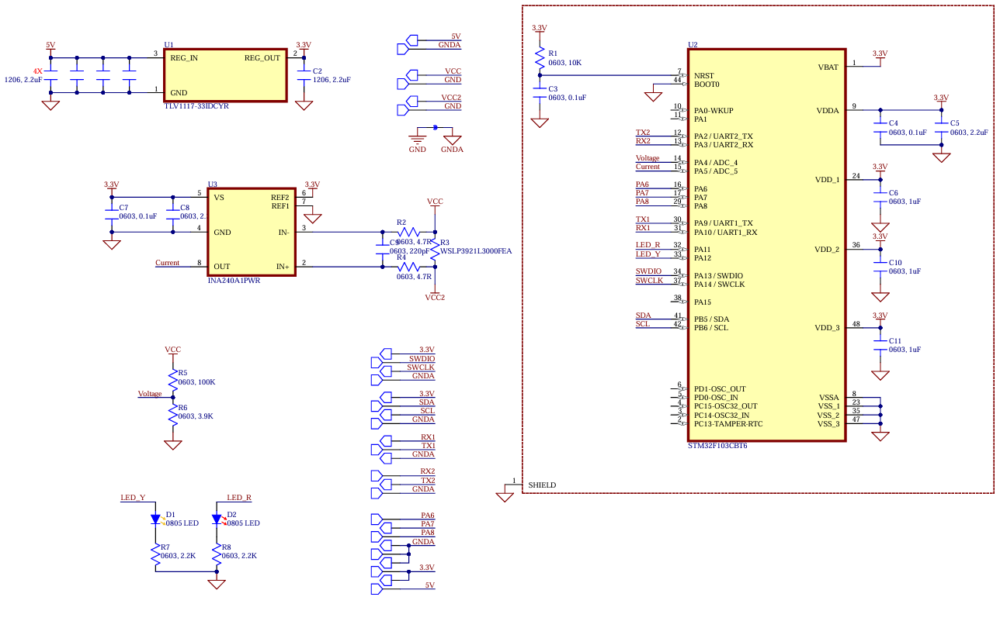

# Voltage and Current Monitor

An STM32-based voltage and current measurement board designed for electrical monitoring and data acquisition applications.

## Overview

This project is a custom-designed electronic measurement board based on the **STM32F103C8T6** microcontroller. It features voltage sensing, high-side current measurement, analog signal processing, and serial communication interfaces.

The board is designed for applications such as battery monitoring, power electronics, embedded systems, and electrical testing.

## Schematic

## Features

- **Microcontroller:** STM32F103C8T6 (ARM Cortex-M3, up to 72 MHz)
- **Voltage Measurement:** Resistive voltage divider
- **Current Measurement:** INA240A1 current sense amplifier
- **Current Shunt:** 0.3 mΩ precision shunt resistor
- **Analog-to-Digital Conversion:** 12-bit ADC
- **Communication Interfaces:**
  - USART
  - I²C
  - SWD (programming and debugging)
- **Power Supply:** 5V input with 3.3V regulation
- **Status Indicators:** On-board LEDs

## Measurement Specifications

### Voltage Measurement

| Parameter | Value |
|---|---|
| Measurement range | 0–87.9 V (theoretical) |
| Voltage divider | 100 kΩ / 3.9 kΩ |
| ADC resolution | 12-bit |
| ADC reference voltage | 3.3 V |
| Theoretical input resolution | ~21.48 mV/LSB |

### Current Measurement

| Parameter | Value |
|---|---|
| Current sense amplifier | INA240A1 |
| Amplifier gain | 20 V/V |
| Shunt resistance | 0.3 mΩ |
| Reference voltage | 1.65 V |
| Theoretical amplifier range | Approximately ±242 A |
| Shunt power rating | 9 W (assumed) |
| Theoretical thermal current limit | Approximately ±173 A |

**Note:** These values are theoretical calculations based on component specifications and circuit design. Actual measurement range and accuracy depend on PCB layout, thermal conditions, component tolerances, ADC calibration, and testing. The maximum continuous current must be validated experimentally.

## Hardware

| Component | Description |
|---|---|
| STM32F103C8T6 | Main microcontroller |
| INA240A1 | Current sense amplifier |
| TLV1117-33 | 3.3V linear voltage regulator |
| Precision shunt resistor | Current measurement |
| Resistor network | Voltage sensing |

## Applications

- Battery voltage and current monitoring
- DC power measurement
- Embedded data acquisition
- Electrical system diagnostics
- Power electronics testing
- Automotive electronics

## Development

The project includes custom-designed schematics and PCB layouts.

Hardware design files are created using **Altium Designer**.

Firmware development is based on the STM32 platform.

## License

This project is licensed under the **CERN Open Hardware Licence Version 2 – Permissive (CERN-OHL-P-2.0)**.

See the [LICENSE](LICENSE) file for details.